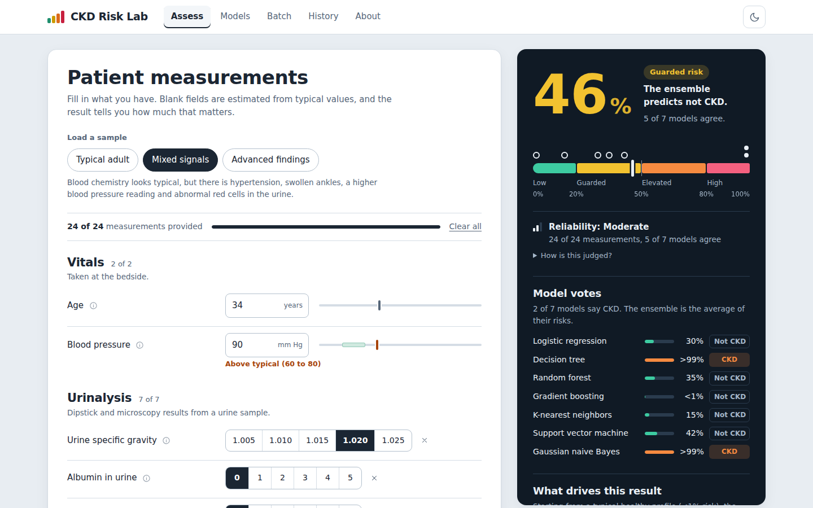
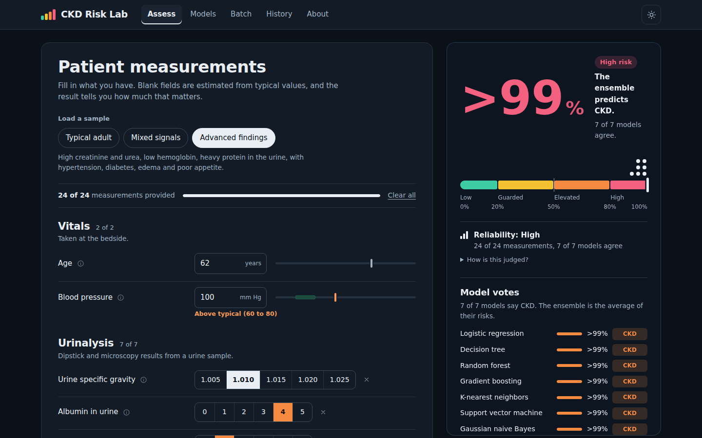
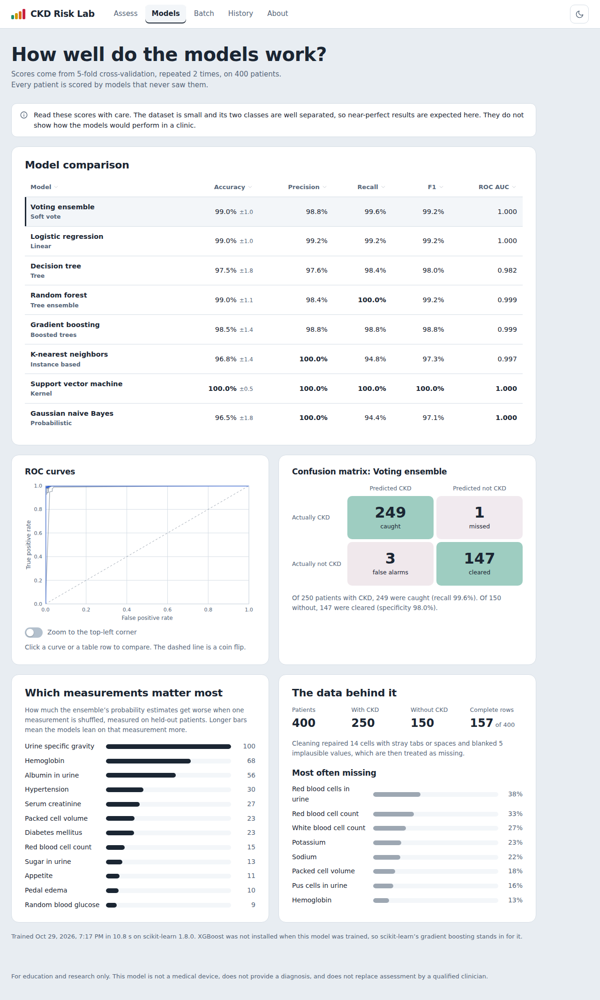
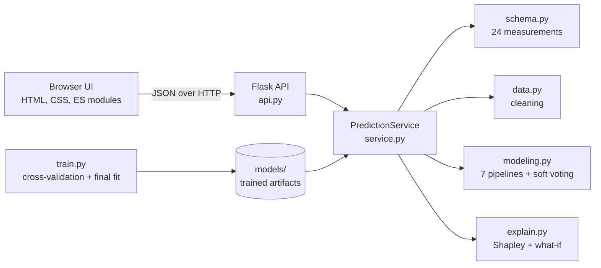

<h1 align="center">CKD Risk Lab</h1>

<p align="center">
  <b>Estimate chronic kidney disease risk from 24 routine clinical measurements,<br>
  see which values drive the result, and test what-if changes.</b>
</p>

<p align="center">
  
  
  
  
  
</p>

<p align="center">
  
</p>

<p align="center">
  <sub>A quick tour: assess a sample patient, switch themes, review the models, then score a whole CSV.</sub>
</p>

> **For education and research only.** CKD Risk Lab is not a medical device and does not provide a diagnosis.

<p align="center">
  <a href="#features">Features</a> ·
  <a href="#quick-start">Quick start</a> ·
  <a href="#how-it-works">How it works</a> ·
  <a href="#results">Results</a> ·
  <a href="#api">API</a> ·
  <a href="#configuration">Configuration</a> ·
  <a href="#tests">Tests</a> ·
  <a href="#docker">Docker</a> ·
  <a href="#limits-and-responsible-use">Limits</a> ·
  <a href="#data">Data</a>
</p>

---

## Overview

CKD Risk Lab is a small, inspectable machine-learning application. You enter whatever clinical measurements you have, and blank fields are fine. Seven classifiers each estimate the probability of chronic kidney disease (CKD), and a soft-voting ensemble averages them into one risk figure. Alongside the number, the app shows how complete the input was, whether the models agree, which measurements pushed the estimate up or down, and how the estimate would change if a value were different.

Under the hood it is a Flask JSON API and a browser interface with no build step (plain HTML, CSS and ES modules), with a 60-test suite and a Dockerfile.

## Features

- **Assess.** A form generated from the API's schema, with units, typical ranges and three sample patients (typical adult, mixed signals, advanced findings) for one-click demos. Any field can be left blank: missing values are imputed inside each model's pipeline, and the result reports how complete the input was. At least 5 measurements are needed.
- **Risk strip.** One axis shows the ensemble risk, every model's own estimate and four risk bands. A tight cluster of dots means the models agree; a spread means the case is near the 50% decision line.
- **Why this result.** Shapley values measured against a typical healthy profile. The contributions add up exactly to the change in risk.
- **What if.** Pick any measurement, drag a slider or the curve, and watch the estimate move. One API call sweeps the range; after that the projection is instant.
- **Models.** Cross-validated accuracy, precision, recall, F1 and ROC AUC for every model, plus ROC curves, a confusion matrix, permutation feature importance and a data-quality summary.
- **Batch.** Upload a CSV, get a scored table you can filter and sort, and download the results.
- **History and report.** Past assessments are kept in the browser only. Any result prints to a clean one-page report (print, then save as PDF).
- **Polish.** Light and dark themes (follows your system setting and remembers your choice), keyboard friendly, responsive down to phone width, and aware of reduced-motion preferences.

## Screenshots

| Light theme | Dark theme | Model evaluation |
| --- | --- | --- |
|  |  |  |

## Quick start

Requires Python 3.10 or newer.

**Windows (PowerShell)**

```powershell
git clone https://github.com/Afhaam11/Machine-Learning-Based-Chronic-Kidney-Disease-Prediction-System.git
cd Machine-Learning-Based-Chronic-Kidney-Disease-Prediction-System
python -m venv .venv
.venv\Scripts\Activate.ps1
pip install -r requirements.txt
python run.py
```

**macOS / Linux**

```bash
git clone https://github.com/Afhaam11/Machine-Learning-Based-Chronic-Kidney-Disease-Prediction-System.git
cd Machine-Learning-Based-Chronic-Kidney-Disease-Prediction-System
python3 -m venv .venv && source .venv/bin/activate
pip install -r requirements.txt
python run.py
```

Open <http://127.0.0.1:8000>. The first launch trains the models, which takes under a minute; after that it starts immediately.

```bash
python run.py --port 9000    # use a different port
python run.py --retrain      # train the models again before starting
python run.py --debug        # Flask development server with auto-reload
python run.py --host 0.0.0.0 # listen on all interfaces (the default is local-only, see Limits)
```

## How it works



| Module | Responsibility |
| --- | --- |
| `ckdlab/api.py` | Flask routes, one JSON error shape, security headers |
| `ckdlab/service.py` | `PredictionService`: predict, explain, what-if and batch scoring, with no HTTP knowledge |
| `ckdlab/schema.py` | One definition of the 24 measurements: validation, encoding and the browser form |
| `ckdlab/data.py` | Cleaning shared by training, CSV uploads and single requests |
| `ckdlab/modeling.py` | Seven scikit-learn pipelines and the soft-voting ensemble |
| `ckdlab/evaluate.py` | Cross-validation, metrics and permutation importance |
| `ckdlab/explain.py` | Shapley explanations and what-if sweeps |
| `ckdlab/train.py` | Training command; writes the artifacts to `models/` |

### The ensemble

Each model is a scikit-learn `Pipeline`: numeric columns are median-imputed and standardised, binary columns are mode-imputed, then the classifier runs. Because preprocessing lives inside the pipeline, it is re-fitted in every cross-validation fold and nothing leaks from held-out patients. The ensemble's risk is the mean of the seven models' probabilities, and the hard-vote tally is reported too.

| Model | Family | Main settings |
| --- | --- | --- |
| Logistic regression | Linear | `C=1.0`, 2000 iterations |
| Decision tree | Tree | max depth 5, min 3 samples per leaf |
| Random forest | Tree ensemble | 300 trees, min 2 samples per leaf |
| XGBoost | Boosted trees | 250 trees, depth 3, learning rate 0.08 |
| K-nearest neighbors | Instance based | `k=7`, distance weighted |
| Support vector machine | Kernel | RBF kernel, probability outputs |
| Gaussian naive Bayes | Probabilistic | defaults |

Every model is smoke-tested before use. If XGBoost cannot be loaded in an environment, scikit-learn's gradient boosting stands in so the ensemble still has seven members.

### Why this result

Contributions are Shapley values, estimated by walking from a typical healthy profile to the patient's values one measurement at a time, over 32 random orderings plus their reverses. Each measurement gets a fair share of the credit even when measurements are correlated, and the contributions add up exactly to `risk(patient) - risk(reference)`. Measurements left blank stay blank on both sides of the walk, so they get no credit and no blame. The same patient always gets the same explanation.

### Reading the risk

| Band | Risk |
| --- | --- |
| Low | below 20% |
| Guarded | 20% to 50% |
| Elevated | 50% to 80% |
| High | 80% and above |

The decision threshold is 50%. Reliability (low, moderate or high) is a rule of thumb that combines how many measurements were provided, how closely the models agree and whether any value falls outside the training range. It is not a statistical confidence interval.

### Data cleaning

One routine in `data.py` serves training, CSV uploads and single requests. It removes stray whitespace and placeholder tokens such as `?`, and blanks implausible values rather than letting them distort a model. On the bundled file that means 5 cells blanked and 14 repaired.

## Results

Evaluation uses stratified 5-fold cross-validation, repeated twice, with a 0.5 threshold and CKD as the positive class. Every patient is scored by models that never saw that patient, and imputation and scaling are re-fitted inside each fold.

| Model | Accuracy | Precision | Recall | F1 | ROC AUC |
| --- | ---: | ---: | ---: | ---: | ---: |
| **Soft-voting ensemble** | **99.0%** | **99.2%** | **99.2%** | **99.2%** | **0.9998** |
| Logistic regression | 99.0% | 99.2% | 99.2% | 99.2% | 0.9997 |
| Decision tree | 97.5% | 97.6% | 98.4% | 98.0% | 0.9824 |
| Random forest | 99.0% | 98.4% | 100.0% | 99.2% | 0.9991 |
| XGBoost | 98.0% | 98.4% | 98.4% | 98.4% | 0.9987 |
| K-nearest neighbors | 96.8% | 100.0% | 94.8% | 97.3% | 0.9973 |
| Support vector machine | 100.0% | 100.0% | 100.0% | 100.0% | 1.0000 |
| Gaussian naive Bayes | 96.5% | 100.0% | 94.4% | 97.1% | 1.0000 |

For the ensemble this is 248 true positives, 148 true negatives, 2 false positives and 2 false negatives (specificity 98.7%). The most influential measurements by permutation importance are urine specific gravity, hemoglobin, albumin in urine, hypertension and serum creatinine.

> The dataset is small (400 patients) and its classes are well separated, so read near-perfect scores as a sign of an easy dataset, not of clinical performance. Exact figures vary a little with library versions; the Models page always shows the numbers for the model being served, and `python -m ckdlab.train` prints them after training.

### What changed from the original version

The project started as a notebook and a Streamlit app (still kept in [`legacy/`](legacy/)). The rewrite fixed several methodological problems along the way.

| Before | Now |
| --- | --- |
| Streamlit app, form hand-coded | Flask API plus a custom front end; the form is generated from `/api/schema` |
| Imputation ran on the whole dataset before the train/test split, leaking test statistics | Imputation and scaling live inside each model's `Pipeline` and are re-fitted in every fold |
| KNN, SVM and logistic regression saw unscaled features | They get standardised inputs |
| Hard voting: a class only, no probability | Soft voting: a risk percentage, plus the vote tally |
| One 80/20 split, 80 test patients | 5-fold stratified cross-validation, repeated twice; every patient is scored by models that never saw them |
| The app encoded appetite as good = 1 while training used poor = 1 | Every encoding is defined once in `schema.py`, with a test |
| Pickles tied to exact library versions | Models retrain on start-up if the scikit-learn version has changed |
| No handling of missing values in the app | Any field can be left blank, and the result says how much that matters |
| Implausible values (sodium 4.5, creatinine 76) were trained on as they were | They are blanked and treated as missing, in training and at prediction time |

## API

Every field is optional, but at least 5 measurements are needed. Binary fields take the dataset's words (`yes`/`no`, `normal`/`abnormal`, `present`/`notpresent`, `good`/`poor`); friendly spellings such as `true` or `absent` also work.

| Method | Path | Purpose |
| --- | --- | --- |
| GET | `/api/health` | Liveness and model info |
| GET | `/api/schema` | Features, units, ranges, risk bands, sample patients |
| GET | `/api/models` | Cross-validated metrics, ROC curves, feature importance |
| POST | `/api/predict` | `{"inputs": {...}, "explain": true}` |
| POST | `/api/sensitivity` | `{"inputs": {...}, "feature": "sc", "points": 41}` |
| POST | `/api/predict/batch` | Multipart upload, field `file` (CSV) |
| GET | `/api/template.csv` | CSV template for batch uploads |

```bash
curl -X POST http://127.0.0.1:8000/api/predict \
  -H "Content-Type: application/json" \
  -d '{"inputs": {"age": 52, "sg": 1.015, "al": 2, "hemo": 11.2, "sc": 2.4, "htn": "yes"}}'
```

Example response, abridged (exact numbers depend on the trained model):

```jsonc
{
  "risk": 0.9997,                       // ensemble probability of CKD
  "label": "ckd",                       // "ckd" when risk >= 0.5
  "band": { "key": "high", "label": "High" },
  "threshold": 0.5,
  "votes": { "ckd": 7, "notckd": 0, "total": 7 },
  "models": [
    { "key": "logreg", "name": "Logistic regression", "risk": 0.9986, "vote": "ckd" }
    // ...one entry per model
  ],
  "completeness": { "provided": 6, "total": 24, "fraction": 0.25, "missing": ["bp", "su", "..."] },
  "reliability": { "level": "low", "summary": "6 of 24 measurements, 7 of 7 models agree" },
  "notes": [
    { "level": "warn", "code": "low_completeness", "features": [], "message": "Only 6 of 24 measurements were provided. ..." }
  ],
  "explanation": {
    "method": "Shapley values against a typical healthy profile",
    "baselineRisk": 0.0773,
    "risk": 0.9997,
    "contributions": [
      { "key": "hemo", "label": "Hemoglobin", "display": "11.2 g/dL", "delta": 0.241 }
      // ...
    ]
  },
  "modelVersion": "<training timestamp>",
  "latencyMs": 87
}
```

Errors always use one shape, with a field-level list for validation problems:

```json
{"error": {"code": "validation_error", "message": "...", "details": [{"field": "sc", "message": "..."}]}}
```

Batch scoring takes a CSV with one patient per row. Column names match the form fields (`age`, `bp`, `sg`, ...), blank cells are fine, and each row needs at least 5 measurements:

```bash
curl -o template.csv http://127.0.0.1:8000/api/template.csv
curl -F "file=@template.csv" http://127.0.0.1:8000/api/predict/batch
```

## Configuration

All settings are optional environment variables.

<details>
<summary><b>Show all variables</b></summary>

| Variable | Default | Meaning |
| --- | --- | --- |
| `CKD_HOST` | `127.0.0.1` | Interface to bind. Patient data is sensitive, so it is local-only by default. |
| `CKD_PORT` | `8000` | Port |
| `CKD_MODEL_DIR` | `models/` | Where trained artifacts are written and read |
| `CKD_DATA_PATH` | `data/kidney_disease.csv` | Training data (same columns as the bundled file) |
| `CKD_AUTO_TRAIN` | `1` | Train automatically when no compatible model exists |
| `CKD_CV_FOLDS`, `CKD_CV_REPEATS` | `5`, `2` | Cross-validation settings |
| `CKD_SEED` | `42` | Random seed |
| `CKD_MAX_UPLOAD_KB` | `1024` | Largest accepted CSV upload |
| `CKD_MAX_BATCH_ROWS` | `2000` | Most rows scored per upload |
| `CKD_LOG_LEVEL` | `INFO` | Logging level |

</details>

To retrain explicitly, run `python -m ckdlab.train` (add `--quick` for a fast run or `--skip-cv` to skip evaluation). To train on your own file:

```bash
CKD_DATA_PATH=path/to/file.csv python -m ckdlab.train
```

```powershell
$env:CKD_DATA_PATH = "path\to\file.csv"; python -m ckdlab.train
```

## Tests

```bash
python -m unittest -v
```

The 60 tests cover value parsing and encoding, data cleaning, predictions, the explanation maths, what-if sweeps, batch scoring, the HTTP API and the first-run behaviour. A small model is trained once per run, so the whole suite takes about ten seconds.

## Docker

```bash
docker build -t ckd-risk-lab .
docker run --rm -p 127.0.0.1:8000:8000 ckd-risk-lab
```

The image trains the models at build time, so the container starts instantly. It runs as a non-root user and includes a health check against `/api/health`.

## Project structure

<details>
<summary><b>Show the folder layout</b></summary>

```
.
├── ckdlab/            the Python package
│   ├── api.py         Flask routes, error handling, security headers
│   ├── service.py     predict, explain, what-if, batch
│   ├── schema.py      the 24 measurements: validation, encoding, form definition
│   ├── data.py        cleaning shared by training, uploads and requests
│   ├── modeling.py    seven pipelines and the soft-voting ensemble
│   ├── evaluate.py    cross-validation and metrics
│   ├── explain.py     Shapley values and what-if sweeps
│   ├── train.py       training command
│   ├── samples.py     example patients for one-click demos
│   ├── config.py      environment-based settings
│   └── static/        front end: index.html, css/, js/ (ES modules), img/
├── data/              kidney_disease.csv, the training data
├── docs/              screenshots and the demo GIF
├── legacy/            the original Streamlit app, notebook and pickles
├── models/            trained artifacts (generated, ignored by git)
├── tests/             unit and API tests
├── Dockerfile
├── requirements.txt
└── run.py             start the server
```

</details>

## Limits and responsible use

- The training data is 400 patients from one published dataset, with many missing values. Treat the numbers as a demonstration of method.
- The typical ranges on the form are general adult reference intervals. Laboratories, age and sex all shift them.
- Reliability is a rule of thumb, not a statistical confidence interval.
- **Privacy.** The server scores what you send and keeps no record of it. History lives in your browser's local storage and can be cleared from the History page. The app binds to `127.0.0.1` by default, API responses are sent with `Cache-Control: no-store`, a strict Content-Security-Policy is set, and uploads are capped (1 MB and 2,000 rows by default).

## Data

The Chronic Kidney Disease dataset from the UCI Machine Learning Repository: 400 patient records, 24 measurements, 250 with CKD and 150 without. Many values are missing: only 157 of the 400 rows are complete, and red blood cells in urine alone is blank for 38% of patients.

Source: Rubini, L., Soundarapandian, P., & Eswaran, P. (2015). [Chronic Kidney Disease](https://archive.ics.uci.edu/dataset/336/chronic+kidney+disease). UCI Machine Learning Repository. [DOI: 10.24432/C5G020](https://doi.org/10.24432/C5G020). Licensed under [CC BY 4.0](https://creativecommons.org/licenses/by/4.0/).

## Author

**Afhaam Asief Ali Muhammed**, AI/ML engineer.
[LinkedIn](https://www.linkedin.com/in/muhammed-afhaam-a-23259b240) · [GitHub](https://github.com/afhaam11)
